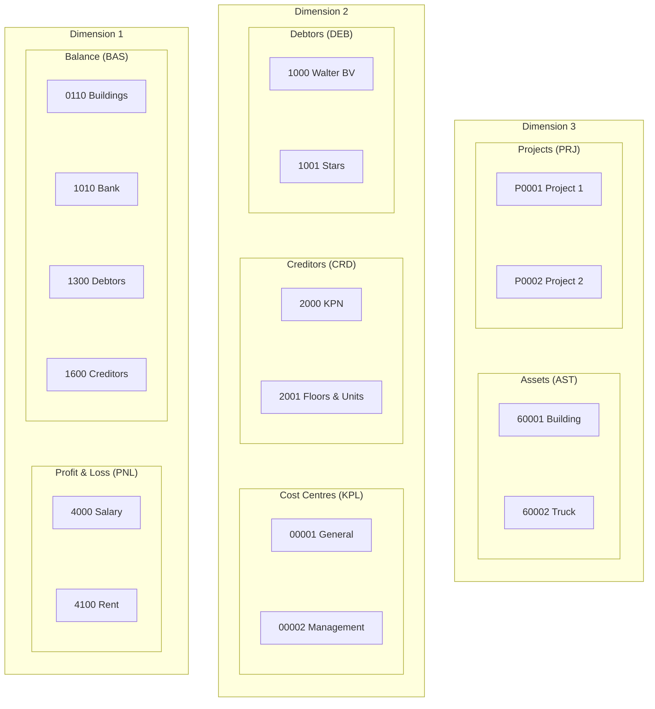

As in most accounting packages, in Twinfield you register financial transactions on general ledger accounts and analyse them further, for example on accounts receivable (customers), accounts payable (suppliers), cost centers, projects or assets. Twinfield calls these **dimensions**. The level of a dimension determines what you can register:

- **Level 1**: the balance sheet and profit and loss accounts.
- **Level 2**: relations (customers and suppliers) and cost centers.
- **Level 3**: projects and assets.

Source: [Dimensions](https://developers.twinfield.com/documentation/getting-started/dimensions) in the Twinfield API documentation.

## With this SDK

Each group in the diagram is a dimension type. The SDK has a resource for each of them, see [Master data (dimensions)](/guides/master-data/):

| Level | Dimension type | Resource |
|---|---|---|
| 1 | Balance sheet (`BAS`) | [`$twinfield->balanceSheetAccounts()`](/guides/master-data/#general-ledger-accounts) |
| 1 | Profit and loss (`PNL`) | [`$twinfield->profitAndLossAccounts()`](/guides/master-data/#general-ledger-accounts) |
| 2 | Customers (`DEB`) | [`$twinfield->customers()`](/guides/master-data/#customers) |
| 2 | Suppliers (`CRD`) | [`$twinfield->suppliers()`](/guides/master-data/#suppliers) |
| 2 | Cost centers (`KPL`) | [`$twinfield->costCenters()`](/guides/master-data/#cost-centers) |
| 3 | Projects (`PRJ`) | [`$twinfield->projects()`](/guides/master-data/#projects) |
| 3 | Fixed assets (`AST`) | [`$twinfield->classicFixedAssets()`](/guides/master-data/#fixed-assets-classic) |

Use [dimension types](/guides/master-data/#dimension-types) to read the settings of a dimension type, such as its name and code mask, and [dimension groups](/guides/master-data/#dimension-groups) for named sets of dimensions, e.g. your key account customers.
