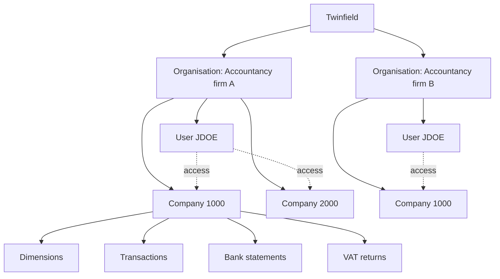

An **organisation** is the top of a Twinfield environment: usually an accountancy firm, or a business with its own Twinfield environment. An organisation has:

- **Companies** (offices, administrations): each company has its own data, such as dimensions (general ledger accounts, customers, suppliers, …), transactions, bank statements and VAT returns.
- **Users**: they log in to the organisation and have access to one or more of its companies.



Only the data of one company is shown; every company has its own.

:::note[Spelling: organisation, not organization]
Most developer tools use the American spelling *organization* (e.g. GitHub). Twinfield uses the British spelling *organisation* everywhere: in the scopes `twf.organisation` and `twf.organisationUser`, the claims `twf.organisationId`, `twf.organisationCode` and `twf.organisationUserCode`, and error codes such as `OrganisationInactive`. The SDK follows Twinfield, so its names match what Twinfield returns and you can search for one spelling: `Organisation`, `$twinfield->organisation()`, `$office->organisation`.
:::

Company and user codes are only unique within their organisation: company `1000` and user `JDOE` exist in both organisations above, but they are different companies and users. A system that stores data of more than one organisation therefore needs the organisation in every key.

## Where the SDK gets it from

The **organisation** comes from the access token: the access token validation has `twf.organisationId` and `twf.organisationCode` (scope `twf.organisation`). Twinfield does not repeat it in API responses, so the SDK adds it to every model it reads.

```php
$organisation = $twinfield->organisation();

echo $organisation->code, ' ', $organisation->id, PHP_EOL; // EXAMPLE 0b6a5f6e-…
```

`RefreshTokenAccessTokenProvider` keeps it from the validation it calls anyway (and caches it with the access token). `StaticAccessTokenProvider` needs it: `StaticAccessTokenProvider::fromValidation($accessToken, $validation)`.

The **company** comes from the response when Twinfield sends it (`<office>` in dimensions, transactions, currencies, …). Otherwise it is the company of the request: the company of the client, or the `company` (or `office`) option of a Finder search.

## On the models

Two value objects in `SolveBeam\Twinfield\Organisation` describe where a model belongs:

| Class | Properties | Equal when |
|---|---|---|
| `Organisation` | `id` (GUID), `code` | `equals()`: same `id` |
| `CompanyReference` | `organisation`, `code` | `equals()`: same organisation and code |

Every model a resource returns carries one of them:

| Level | Models | Property |
|---|---|---|
| Organisation | `Office`, `OfficeSummary`, `User`, `UserSummary` | `$model->organisation` |
| Company | Dimensions (customers, suppliers, …), their summaries, bank and cash books, currencies, VAT codes, rates, asset methods, dimension groups and types, periods, deleted transactions, budget totals, open invoices | `$model->company` |
| Company | Bank, cash and sales transactions | `$transaction->header->company` |

```php
$customer = $twinfield->customers()->get('1000');

$customer->company->organisation->id;   // 0b6a5f6e-…
$customer->company->organisation->code; // EXAMPLE
$customer->company->code;               // 1000 (the company)
$customer->code;                        // 1000 (the customer)
```

Input objects (`CustomerInput`, …) have no organisation: you send them with a client, and the client decides the company.

## Clients for a company

`$twinfield->company()` takes a code, an `Office`, an `OfficeSummary` or a `CompanyReference`, e.g. the `company` of a model. With an object, it checks that the company belongs to the organisation of the access token, and throws an `InvalidArgumentException` when it does not. So data of one organisation is never sent with the access token of another.

```php
$client = $twinfield->company($customer->company);

$twinfield->companyReference(); // the company of the client, with its organisation
```

`User::hasAccessTo()` takes the same objects, and is false for a company of another organisation.

## Keys for a shadow database

Store the parts of the key in separate columns, not as one string. Use the organisation `id` (GUID) as key and keep the `code` for display.

| Data | Key |
|---|---|
| Organisation | `organisation.id` |
| Company | `organisation.id` + company `code`, or `OfficeSummary::companyId` (a GUID) |
| User | `organisation.id` + user `code` |
| Dimension (customer, supplier, project, …) | `organisation.id` + company `code` + dimension type + `code`; dimensions also have a `uid` |
| Bank, cash book, currency, VAT code, … | `organisation.id` + company `code` + `code` |
| Transaction | `organisation.id` + company `code` + day book + number |
| Deleted transaction | `organisation.id` + company `code` + day book + number |

A person can have users in several organisations. Twinfield only links them with a Twinfield ID: the `twf.id` claim of the scope `twf.user`, for users that have one.
